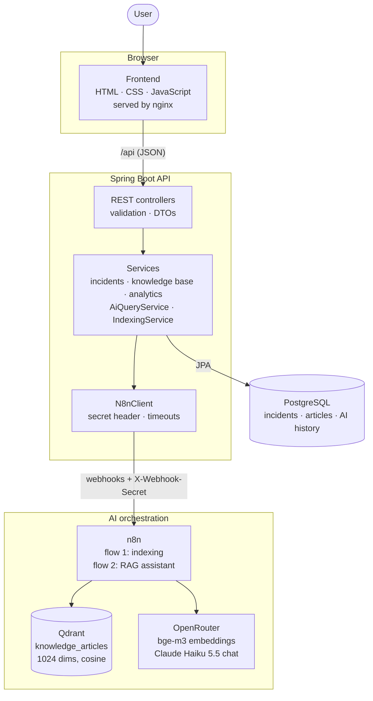
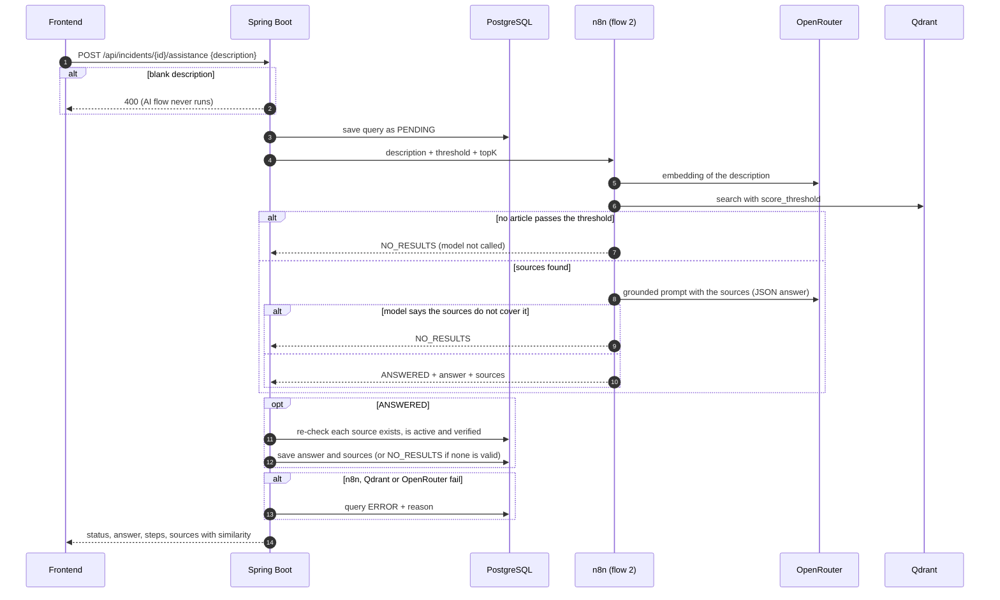
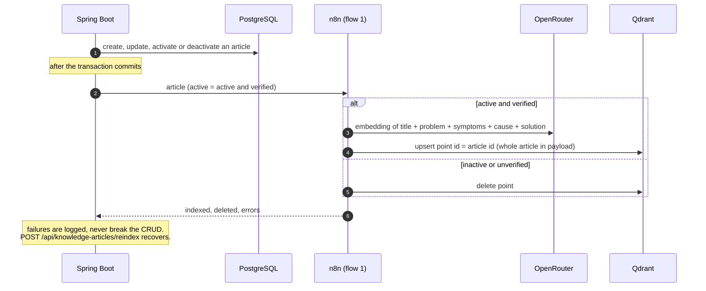

# Architecture

The frontend only talks to Spring Boot. Spring Boot owns the business rules and the relational data, and it is
the only component that calls n8n. n8n orchestrates the AI: embeddings and chat through OpenRouter, vector
search in Qdrant. Keys live in environment variables (`.env`), never in code or workflows.

## Components

## RAG query (RF04 / RF05)

## Indexing (RF02 / RF03)

## Safeguards against made-up answers

1. **Threshold** (0.60, calibrated): below it the model is never called.
2. **Prompt:** the model may answer `relevant: false` when the sources do not cover the problem.
3. **Database check:** Spring Boot drops any source that no longer exists or is inactive or unverified.
