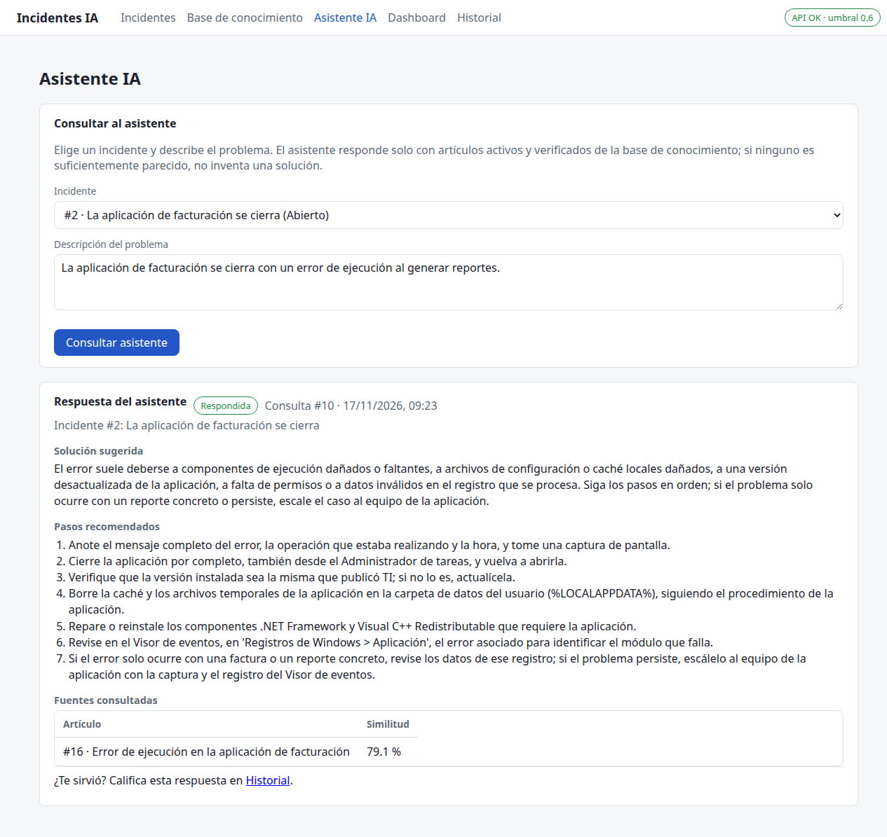
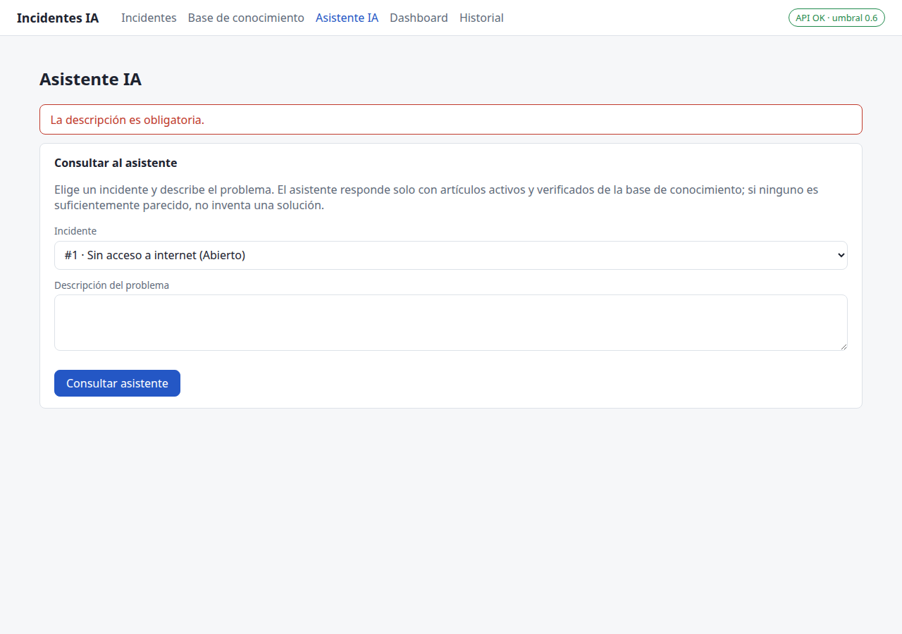

# AI tests: evidence (tests 1, 2, 3, 6, 7 and 8)

Mandatory tests of the RAG assistant (member C). Every call goes through Spring Boot
(`POST /api/incidents/{id}/assistance`), like the frontend; n8n, Qdrant and OpenRouter are never called directly.

**Run:** 2026-11-17 11:51, on the final seed (`02_seed.sql`: 150 incidents, 25 active and verified articles) with the
whole stack in Docker and every request through nginx (`http://localhost:8081/api`). Threshold 0.60, top-k 5,
embeddings `baai/bge-m3`, chat `anthropic/claude-haiku-5.5`. **Result: 6/6 passed.**

An earlier run (09:28, before the seed existed, backend outside Docker) gave the same statuses and similarities.

Script: [`scripts/testing/run_ai_tests.py`](../../scripts/testing/run_ai_tests.py). It creates its own incidents
and leaves the knowledge base and n8n as it found them.

## Results

| # | Test | Input | Expected | Result |
|---:|---|---|---|---|
| 1 | Connectivity incident gets relevant solutions through RAG | "No hay conexión a internet en el piso 3 desde esta mañana." | `ANSWERED` with the internet article as a source | **Pass.** Query 1: `ANSWERED`, source #1 "Sin acceso a internet en el equipo" (0.641), 7 steps, 4.9 s |
| 2 | Application runtime error retrieves the right articles | "La aplicación de facturación se cierra con un error de ejecución al generar reportes." | `ANSWERED` with the application error article | **Pass.** Query 2: `ANSWERED`, source #16 "Error de ejecución en la aplicación de facturación" (0.791), 7 steps |
| 3 | Not enough information: the model must not make up a solution | "La impresora 3D del laboratorio no completa la calibración de la cama." (topic without article) | `NO_RESULTS`, no answer, no sources | **Pass.** Query 3: `NO_RESULTS` in 0.9 s; the model is not called |
| 6 | Deactivated article is not used as a source | Article #1 deactivated with `PATCH /api/knowledge-articles/1/deactivate`, then test 1 repeated | Article #1 is not a source | **Pass.** Query 4: `NO_RESULTS`. After `PATCH .../activate`, query 5: `ANSWERED` with #1 again |
| 7 | Blank description does not run the AI flow | `{"description": "   "}` | 400, no query created | **Pass.** 400 with `fields.description = "La descripción es obligatoria"`; the incident still has only its 2 queries from test 6 |
| 8 | Embedding service failure is handled | n8n restarted with an invalid OpenRouter key | Query stored as `ERROR` with the reason, no crash | **Pass.** Query 6: HTTP 200 with `status: ERROR`, `errorMessage: "AI service responded with error 502: Embed question failed: 401 ..."` |

## Stored history

`ai_queries` with the sources saved in `response_sources` after the run (the seed has no queries, so these are the
only rows; incidents 151–155 were created by the script after the 150 seeded ones):

| Incident | Query | Status | Error | Sources (article:similarity) |
|---:|---:|---|---|---|
| 151 | 1 | ANSWERED | | 1:0.641 |
| 152 | 2 | ANSWERED | | 16:0.791 |
| 153 | 3 | NO_RESULTS | | |
| 154 | 4 | NO_RESULTS | | |
| 154 | 5 | ANSWERED | | 1:0.641 |
| 155 | 6 | ERROR | AI service responded with error 502: Embed question failed: 401 … | |

## Why each test passes

- **Tests 1 and 2:** the threshold (0.60, see [threshold calibration](../threshold-calibration.md)) lets the right
  article through, and the answer is built only from it.
- **Test 3:** no article reaches 0.60, so n8n returns `NO_RESULTS` without calling the model.
- **Test 6:** two barriers. Deactivating removes the point from Qdrant (indexing listener), and Spring Boot also
  re-checks every source against the database, so an article still present in Qdrant is dropped anyway
  (checked separately by deactivating it only in the database).
- **Test 7:** `@NotBlank` on `AssistanceRequest` rejects the request before the service runs.
- **Test 8:** `AiQueryService` never throws on AI failures: the query ends as `ERROR` and keeps the failing step
  reported by n8n.

## Assistant view

Screenshots of the same cases in the frontend (`#assistant`), taken in a headless Chrome on 2026-11-17:

| Test 1 | Test 2 |
|---|---|
|  |  |

| Test 3 | Test 7 |
|---|---|
|  |  |

## How to repeat

```bash
docker compose up -d --build                                   # plus the first-run steps in the main README
curl -X POST http://localhost:8081/api/knowledge-articles/reindex
python3 -I scripts/testing/run_ai_tests.py --api http://localhost:8081/api --json ai-tests-results.json
# --skip-test-8 avoids restarting n8n
```
