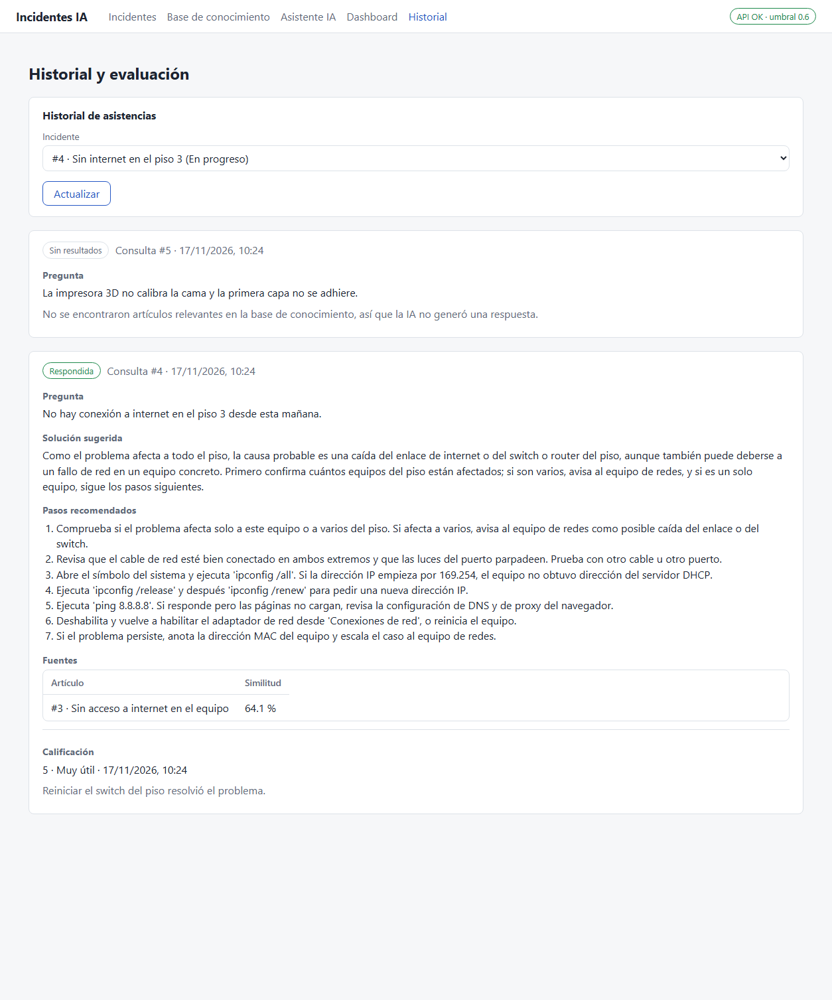
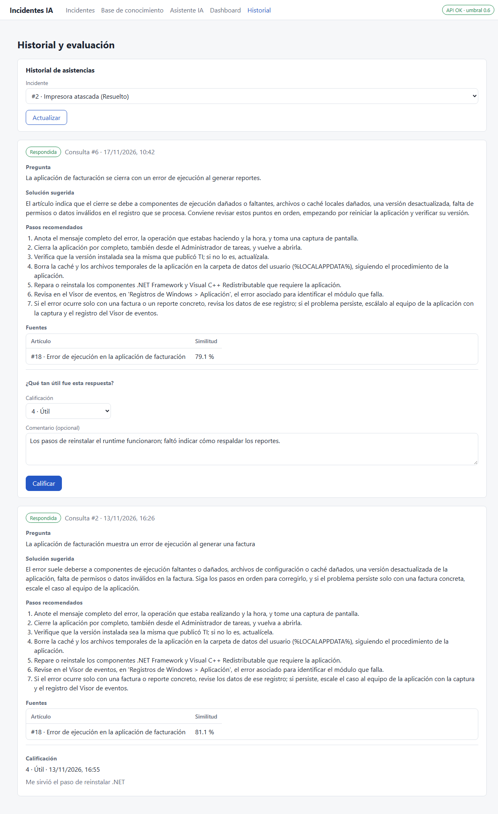
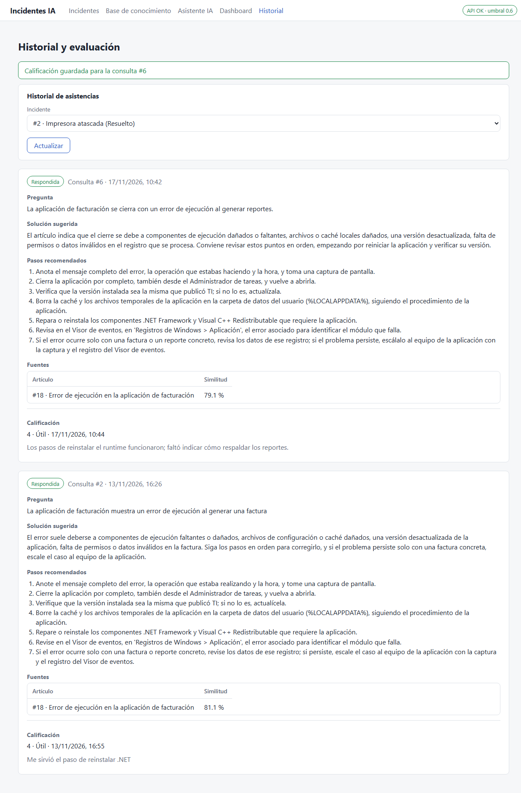

# History and rating tests: evidence (tests 9 and 10)

These are the mandatory tests of RF08, owned by member B. The calls go through Spring Boot, the same way the frontend calls it:

- `GET /api/incidents/{id}/queries` (history)
- `POST /api/responses/{id}/rating` (rating)

**Run:** 2026-11-17 against the Docker stack (threshold 0.60, top-k 5). **Result: 2/2 passed.**

The tests were checked three ways:
- the API, with the [Postman collection](../postman/incidents-rag.postman_collection.json): 36 requests, 48 assertions, 0 failures;
- the **Historial** view (`#history`);
- the database.

## Results

| # | Test (statement) | Input | Expected | Result |
|---:|---|---|---|---|
| 9 | Consultar el historial de asistencias generadas para un incidente | `GET /api/incidents/4/queries` on an incident with one `ANSWERED` query and one `NO_RESULTS` query | Every query of the incident, newest first, with status, date, question, answer, steps, sources with similarity, and rating | **Pass.** 200 with 2 items: query 5 `NO_RESULTS` (no answer and no sources) and query 4 `ANSWERED` (7 steps, source #3 "Sin acceso a internet en el equipo" at 0.641, rating 5). Unknown incident: 404 |
| 10 | Calificar una respuesta y verificar la persistencia del registro | Score 4 and a comment for response 4 (query 6), sent from the history view | 201, row stored in `ratings`, and the rating shown in the history from then on | **Pass.** 201. Row `id = 5` (score 4) stored in `ratings` and returned by the history API. A second rating of the same answer gets 409; score 6 gets 400 |

## Test 9: history of an incident

The view lists the queries of the selected incident from newest to oldest. What each card shows depends on the query status:

- **Respondida** (`ANSWERED`): the solution, the numbered steps, the sources with their similarity, and the rating, or the rating form if the answer has not been rated yet.
- **Sin resultados** (`NO_RESULTS`): a message saying that no relevant article was found, so the AI did not generate an answer.
- **Error** (`ERROR`): the reason the query failed.



API response for the same incident, from the Swagger screenshot [05](../postman/screenshots/05-history-test9.png):

```json
[
  { "queryId": 5, "status": "NO_RESULTS", "responseId": null, "answer": null, "sources": [], "rating": null },
  { "queryId": 4, "status": "ANSWERED", "responseId": 3,
    "answer": { "solution": "Como el problema afecta a todo el piso…", "steps": ["…7 steps…"] },
    "sources": [{ "articleId": 3, "title": "Sin acceso a internet en el equipo", "similarity": 0.641 }],
    "rating": { "score": 5, "comment": "Reiniciar el switch del piso resolvió el problema." } }
]
```

The values in `"…"` are shortened here; the API returns the full text.

## Test 10: rate an answer and check that it is stored

1. **Unrated answer.** Query 6 on incident 2, *"La aplicación de facturación se cierra con un error de ejecución al generar reportes."*, came back `ANSWERED` with source #18 at 0.791. Because it has no rating yet, its card shows the form. The user picks *4 · Útil* and writes a comment:

   

2. **Rating saved.** The API answers 201, the form is replaced by the stored rating, and the view confirms *"Calificación guardada para la consulta #6"*:

   

3. **Stored in the database:**

   ```text
    id | response_id | query_id | incident_id | score | comment                                                                                    | created_at
   ----+-------------+----------+-------------+-------+--------------------------------------------------------------------------------------------+-------------------------------
     5 |           4 |        6 |           2 |     4 | Los pasos de reinstalar el runtime funcionaron; faltó indicar cómo respaldar los reportes. | 2026-11-17 10:44:51.871388-05
   ```

4. **Returned by the history.** `GET /api/incidents/2/queries` now returns the rating with query 6, so the view shows it whenever the incident is opened again:

   ```json
   { "queryId": 6, "status": "ANSWERED", "responseId": 4,
     "rating": { "id": 5, "responseId": 4, "queryId": 6, "score": 4,
                 "comment": "Los pasos de reinstalar el runtime funcionaron; faltó indicar cómo respaldar los reportes.",
                 "createdAt": "2026-11-17T15:44:51.871388Z" } }
   ```

### Rules checked around the rating

| Case | Result | Evidence |
|---|---|---|
| Second rating of the same answer | 409 *"Esta respuesta ya fue calificada"*; the first rating is kept | Swagger [06](../postman/screenshots/06-rating-duplicate-409.png), Postman |
| Score outside 1–5 (`score: 6`) | 400 with `fields.score = "La calificación máxima es 5"` | Swagger [07](../postman/screenshots/07-rating-out-of-range-400.png), Postman |
| Answer that does not exist | 404 | Postman |
| Comment with surrounding spaces, or blank | Stored trimmed; a blank comment is stored as `null` | `RatingServiceTest` |
| Two ratings sent at the same time | The unique constraint on `ratings.response_id` rejects the second one, and it is answered as 409 | `RatingServiceTest` |

## Why each test passes

- **Test 9:**
  - `QueryHistoryService` reads the incident's queries, then their responses with their sources and articles, then the ratings. That is always 3 selects, however many queries the incident has.
  - It builds one item per query and sorts the sources by similarity, highest first.
  - A query that has no response yet (`NO_RESULTS` or `ERROR`) is still listed, without an answer.
- **Test 10:**
  - `RatingRequest` validates the score (1 to 5, required) and the comment (up to 500 characters) before the service runs.
  - `RatingService` checks that the response exists and has no rating yet, then stores the rating with `saveAndFlush`. The unique constraint in the schema is the last barrier, and its error is turned into 409.
- **Unit tests:** `QueryHistoryServiceTest` (5), `RatingServiceTest` (5) and `RatingRequestTest`.

## How to repeat

```bash
docker compose up -d --build
# with OPENROUTER_API_KEY in .env, the n8n workflows active and the articles indexed
npx newman run docs/postman/incidents-rag.postman_collection.json --timeout-request 90000
```

- **With the collection:** folders 5 and 6 create a new answer, check the history (test 9), rate it (test 10), and check the 409, 400 and 404 cases.
- **From the UI:** open `http://localhost:8081/#history`, pick an incident that has an unrated answer, rate it, then press **Actualizar**. The stored rating replaces the form.
